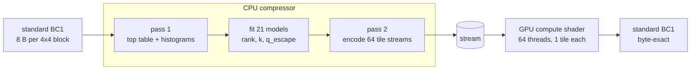
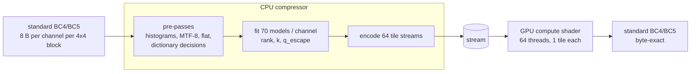

# BC packed

[](https://github.com/geolm/bc_packed/actions)

An asymmetric lossless compressor for BC1, BC4 and BC5 textures, designed for fast GPU decompression. The compressor is CPU-side; at runtime the stream is uploaded to the GPU and a compute shader writes the result back to standard texture memory.

| Hardware |  Processor | BC1 throughput                |
|:-----: | :------------: | ----- |
|      M5 Pro | CPU 18 cores | 2500 MiB/s      |
|      M5 Pro | GPU | 15300 MiB/s      |
|      M2 Max | CPU 12 cores | 1300 MiB/s      |
|      M2 Max | GPU | 11850 MiB/s      |
| AMD 5945WX | CPU 24 cores  | 1375 MiB/s |

| Block type |  Average compression from the image suite |
|:-----: | :------------:
| BC1 | 1.49:1
| [BC4](logs/bc4_zip.md) | 1.36:1
| BC5 | 1.1:1

All compression ratios are better than zlib.

Note: AI disclaimer, although everything is based on my ideas and my previous libraries, almost all the code was written by a LLM. It wouldn't have been possible with my fulltime job otherwise.

## Library

* One `.c` + one header, no dependencies — API in [bc_packed.h](src/bc_packed.h).
* GPU shader in [bc_decompress.metal](src/bc_decompress.metal) (Metal; should translate easily to HLSL).
* Decompression (CPU or GPU) is multi-thread capable. Everything is unit tested, including the shader (macOS only).

## Design goals

* Lossless, byte-exact.
* Standard BC1/3/4/5 in, standard BC out, usable directly as a texture.
* GPU decompression = one compute shader
* 64 independent tiles, one GPU thread per tile, no dependency between threads.
* CPU decompression on multiple thread available

## BC1



* **Rice-Golomb coding** instead of arithmetic/Huffman — decoding is integer math + bit manipulation only.
* **Static symbol ranking** — frequent symbols get the lowest indices; rank tables come from a histogram.
* **Parallel decompression** — 64 independent tiles, no inter-thread state.

21 static models: 18 color slots (16 distinct, see [Endpoints](#endpoints)) + top-table reference + difference mask + difference bytes.

### Rice-Golomb model

Shared by all formats. Each model: symbol count, Rice `k`, raw-byte escape `q_escape`, rank table.

| Offset |  Size (bytes) | Description                |
| -----: | ------------: | -------------------------- |
|      0 |             1 | Number of symbols − 1      |
|      1 |             1 | Rice `k` value             |
|      2 |             1 | Raw-byte escape `q_escape` |
|      3 | `num_symbols` | Sorted rank table          |

* Rank table: only symbols that occur, sorted by frequency (ties: lower symbol first). Max size `3 + 256 = 259` bytes, no padding between models.
* A rank is `q = rank >> k` unary ones, a zero, then `k` remainder bits.
* A rank with `q >= q_escape` is written as `q_escape` ones, a zero, then the full 8-bit rank as a raw byte.
* `(k, q_escape)` are searched jointly against the histogram to minimize total bits.
* Near-uniform histograms fall back to a raw fixed-width code: bit 7 of `k` set, lower bits = width `ceil(log2(num_symbols))`; `q_escape` unused. Single-symbol models keep the Rice path.

### Two passes

1. Build the top table, collect the histograms, sort the rank tables, choose `k` / `q_escape`.
2. Encode the stream.

### 64 tiles

```text
             gx = 8            (each tile: 32 x 8 blocks)
        ┌──────┬──────┬──────┬───┬──────┐
   row0 │  t0  │  t1  │  t2  │   │  t7  │
        ├──────┼──────┼──────┼───┼──────┤
        │  t8  │  t9  │ t10  │   │ t15  │
        │  ... │      │      │   │      │
        ├──────┼──────┼──────┼───┼──────┤
   row7 │ t56  │ t57  │ t58  │   │ t63  │
        └──────┴──────┴──────┴───┴──────┘
```

* `tile s = (tx, ty) = (s % gx, s / gx)`; `gx` = 8 / 4 / 2 / 1 for `width_blocks` 32+ / 16+ / 8+ / less, `gy = 64 / gx`; derived from the width only.
* The even split covers every row and column even when the grid is not a multiple of the tile size.
* Each thread loads the same 21 models (`le_static_model_load`); no adaptive state to sync.
* 63 `uint16` tile offsets in the stream (dword deltas from the previous tile; tile 0's is implicit).

### Endpoints

* Predicted from the previous block; chroma deltas decorrelated against the green delta:

```text
green_delta = current_green - previous_green
red_delta   = (current_red   - previous_red)  - green_delta / 2
blue_delta  = (current_blue  - previous_blue) - green_delta / 2
```

* R5G6B5 ⇒ deltas fit in 7 bits; stored unsigned, offset by 64, Rice-Golomb encoded.
* Contexts (16 distinct models, 18 stream slots):
  * red, blue: one model per 3-bucket context of the endpoint's own green delta (negative / zero / positive)
  * endpoint 0 green: uncontexted (its two other slots are fixed dummy models)
  * endpoint 1 green: context = sign of endpoint 0's green delta
* **Zigzag order** — a tile's blocks are traversed in zigzag:

```text
   0  1  2  3  4
   9  8  7  6  5
  10 11 12 13 14
  19 18 17 16 15

   zigzag_x = tb.x0 + ((y & 1) ? x : tile_width - x - 1)
```

* No previous block at the start of a tile: each tile's first block is predicted from the **tile seed** (an endpoint color pair in the header).

### Per-tile predictor

One bit per tile in the header:

```text
   zigzag-previous (default)        row-above
   ─────────────────────────        ─────────
   0 → 1 → 2 → 3                   0  1  2  3
   7 ← 6 ← 5 ← 4                   4  5  6  7
   8 → 9 →10 →11                   8  9 10 11
   each block is predicted from     each block is predicted from the
   the previous block of the        block of the row above at the same
   zigzag chain (in-row neighbor)   zigzag position
```

* A pre-pass sums each predictor's |delta| magnitude per tile; the cheaper one wins.
* 74-image suite: 1.41 → 1.43 (colors −2.7%), 58/74 improve, worst −0.01%.
* Row-above removes the serial zigzag chain: a whole row decodes in parallel.

### Color-pair dictionary

* Sliding dictionary of the last 256 endpoint-color *pairs* per tile (ring buffer, 32-bit entry = the two 565 colors packed).
* Enabled tiles write one flag bit per block before the deltas:
  * **Hit** — reference = distance to the most recent match − 1, in `ceil(log2(min(position, 256)))` bits (0 bits for the first block, 8 bits once the window is full); the six deltas are skipped and the decoder copies the referenced block's colors.
  * **Miss** — the six color deltas, as in [Endpoints](#endpoints).
* Match decided on decoded colors only — identical on encoder and decoder, independent of the predictor.
* A matched block still emits its top-table reference, mask, and difference bytes.

**Per-tile enable** (one bit per tile, 8-byte header word):

* A tile is enabled iff its matched blocks' savings (six deltas saved − reference paid) exceed the flag cost.
* Disabled tiles write exactly the six deltas, no flag — zero overhead.
* Final color models are refit on the deltas actually emitted.
* 74-image suite: 1.4587 → 1.4654 (44 improve, 25 byte-identical, 5 regress ≤ 0.14%); structured content gains up to +2.95%. See `failed_experiments.md`, exp. 20.

### Indices

**Top table**

1. Histogram every unique 32-bit index pattern.
2. Keep the Top 256.
3. Refine with vector quantization — stochastic bit-level K-Means: jittered sampling with error-feedback assigns blocks to centroids by Hamming distance; centroids refined by bitwise majority vote (flip bits differing in >50% of assigned blocks). First + two final rounds are full assignments, jittered middle rounds explore. See `failed_experiments.md`, exp. 15.
4. Clusters with ≤ 1 block are dropped — the table may hold fewer than 256 entries. An empty table (tiny inputs) becomes a single entry, the most frequent exact pattern (the size is stored as `entries − 1` in one byte).

**Block indices** — closest top-table entry by Hamming distance:

```text
distance = popcount(block_indices XOR table_entry)
```

```text
   block indices (32 bits)
   ┌──────────┬──────────┬──────────┬──────────┐
   │  byte 0  │  byte 1  │  byte 2  │  byte 3  │
   └────┬─────┴────┬─────┴────┬─────┴────┬─────┘
         │          │          │          │
         ▼          ▼          ▼          ▼
    mask bit 0   mask bit 1   mask bit 2   mask bit 3
```

* Payload: 8-bit top-table reference + 4-bit mask (which difference bytes are non-zero) + one difference byte per set bit, all Rice-Golomb.

**Flat blocks** — identical endpoints ⇒ uniform index word (all 16 indices hold one 2-bit value).

* Global mode decided in the first pass: mode 1 iff at least one block has identical endpoints and every such block holds the same value.
* Mode 1: a flat block stores no index payload; the header value expands to all 16 indices on decode.
* Header: one byte `mode | value << 1` after the top-table size.

### Stream

* Self-describing: no width / height / format in the stream — the user stores that.
* Output buffer ≥ `packed_bc1_maxsize(w, h) = (w/4) * (h/4) * 16` (2× standard BC1; actual streams are much smaller).

## BC4 / BC5

BC4 (one 8-bit channel), BC5 (red + green). Reuse the BC1 machinery: static Rice-Golomb models, 64 tiles, self-describing stream. Entry points `packed_bc4_maxsize` / `bcp_compress_bc4` / `bcp_decompress_bc4` (same for `bc5`), same signature shape as BC1.



**Blocks** — standard D3D layout, byte-exact:

```c
// 8 bytes per 4x4 block
uint8_t endpoint[2]; // [0] = max endpoint, [1] = min endpoint (as stb writes them)
uint8_t indices[6];  // little-endian 48-bit field: 16 x 3-bit indices, index 0 = top-left
```

* A BC5 block is the red block followed by the green one (16 bytes).

**Endpoints**

* Two 8-bit endpoints per channel; the wrapped delta `curr − pred` (mod 256) is encoded with one static 256-symbol model per (channel, endpoint).
* Fixed predictor, no per-tile flag:

```text
first row of a tile:   pred = previous        (the tile seed for the first block)
start of a row:        pred = top
other blocks:          pred = previous + top − top_previous   (mod 256)
```

* `previous` = chain-previous block (BC1 zigzag order), `top` = block above at the same column, `top_previous` = above the chain-previous. All references stay inside the tile.
* Tile seed: per-endpoint average of the first block of each tile, stored in the header.

**Endpoint MTF-8** — optional, one flag bit per channel (bit 4 of the flat-index header byte). Replaces the two endpoint deltas with one symbol of a 9-symbol model:

```text
MTF list (8 entries, cleared per tile) = last distinct (endpoint0, endpoint1) pairs

rank 0..7  → pair at that list position (the pair moves to the front)
rank 8     → escape: the two wrapped endpoint deltas; the new pair is inserted at the front
```

* The first pass prices the histogram with and without MTF and keeps the cheaper per channel (a disabled channel writes a dummy 1-symbol model).
* Endpoint models are fitted on the escaped blocks when the flag is set, on every block otherwise.
* Repeated endpoint pairs (atlas-style content) switch on; natural textures keep the deltas.

**Indices** — encoded in raster order:

```text
index 0:  static 8-symbol model (the Rice/raw fallback of the fitter is the self-gate)
index i:  symbol = prediction XOR index[i], static 8-symbol model
          prediction = index[i-1]   (left)
                       index[i-4]   (above, rows at offset 4/8/12)
          context    = left * 8 + top  →  64 models + 1 first-index model per channel
```

* Missing neighbor defaults to 0. 8-symbol models use a compact 8-entry rank table (`3 + num_symbols ≤ 11` bytes each).

**Flat blocks** — per-channel mode 1 when at least one block has identical endpoints and every such block holds the same 3-bit value; flat blocks then store no index payload. One header byte per channel: `mode | value << 1`.

**Index-word dictionary**

* Per (channel, enabled tile): a move-to-front list of at most 255 distinct 48-bit index words (the block's six index bytes):

```text
rank 0..254 → copy the word at that list position into the block's indices
rank 255    → escape: the full payload; the word is inserted at the front
```

* Enabled per tile by one global per-channel decision (third pre-pass): a tile is enabled iff the hit payloads it skips outweigh the rank symbols it adds (priced with the fitted models; one rank model per channel for the whole image).
* A channel with no enabled tile pays only the dummy 1-symbol rank model slot + its 8-byte tile word.

**Stream** — self-describing, as BC1 (no width / height / format); the BC4/BC5 decompressors are separate entry points and know their own header.

**Status**

* CPU + GPU; the Metal kernels `bcp_decompress_bc4` / `bcp_decompress_bc5` are bit-identical to the CPU (one thread per tile). M5 Pro 1024×1024: **14540 MiB/s** BC4, **7868 MiB/s** BC5.
* `width >= 16`, `height >= 256` (multiples of 4).
* Output buffer ≥ `packed_bc4_maxsize` / `packed_bc5_maxsize` (2× standard block size: 16 / 32 bytes per 4×4 block).

**Validation** — byte-exact over all 64 tiles, CPU and GPU:

* GPU: the brick AO / normal maps (1024×1024, `images/bc4` / `images/bc5`) + a synthetic 256×256 texture with repeating endpoint pairs and index words (exercises the index-word dictionary). Run with the Metal validation layer on (`METAL_VALIDATION=1 ./build/unit_tests`).
* CPU: 14 synthetic 256×256 roundtrips (flat / checkerboard / gradient / SplitMix32 random, as BC4 and BC5, flat-index variants, per-channel independence; repeated pairs and cycling words asserted strictly smaller than their all-distinct controls). Tests check results only — byte-exact roundtrips and stream sizes.
* CPU: 6 maps (`images/bc4`) + 4 normal maps (`images/bc5`) via stb_dxt; suite average must stay above 1.05. Measured: **1.3608:1** BC4 (1.0920 – 2.4040, the max being the mostly-flat font atlas) and **1.0985:1** BC5 (1.0629 – 1.1339); zlib achieves 1.010563:1 on the same images.

The 8-bit formats leave less headroom than BC1: the indices sit close to 3 near-uniform bits each, so most of the gain comes from the endpoint deltas.

## BC3

BC1 color + BC4 alpha in the standard D3D layout, 16 bytes per 4×4 block. Entry points `packed_bc3_maxsize`, `bcp_compress_bc3`, `bcp_decompress_bc3` (same signature shape as BC1).

* **Scheme** — composition of the two pipelines: BC1 on the color half, single-channel BC4 on the alpha half. No payload logic, model, or context state is new — the tiles, zigzag chains, predictors, top table, dictionaries, and models are all the existing ones, fitted on their own half.
* **Stream** — self-describing: a u32 LE prefix (BC1 substream size), then the BC1 stream of the color half, then the BC4 stream of the alpha half (1 channel). Each substream is self-contained; the halves share the 64-tile split, so one `bcp_decompress_bc3` call decodes one tile of both.
* **Status** — CPU only (BC3 is niche; no Metal decoder, the BC1/BC4 kernels cover the two halves). `width >= 16`, `height >= 256`. Output buffer ≥ `packed_bc3_maxsize` (2× 32 bytes per 4×4 block) + 4-byte prefix.
* **Validation** — byte-exact on CPU: 4 synthetic 256×256 roundtrips (flat / checkerboard / gradient / random, both halves at once); 2 albedo + alpha maps (`images/bc3`), suite average must stay above 1:1 — measured **2.8787:1** (3.2210:1 leak-stain_albedo, 2.5364:1 leaves).

## Images

The images used in the unit tests come from:

* https://opengameart.org/content/tiny-texture-pack-2
* https://r0k.us/graphics/kodak/

The `images/bc3` set (albedo + alpha maps) is used by the BC3 suite; the leak-stain and leaves sources are the project author's own assets.
